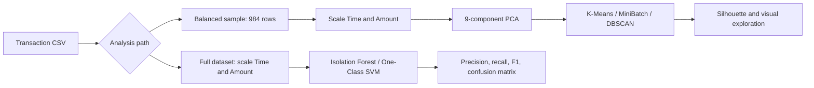

<div align="center">

# Credit Card Fraud Detection

### Explore rare transactions. Measure the trade-off.

**Clustering · PCA & t-SNE · Isolation Forest · One-Class SVM**


[Overview](#overview) · [Workflow](#workflow) · [Results](#results) · [Run Locally](#run-locally)


</div>

## Overview

An exploratory machine-learning study of **credit-card fraud in a highly imbalanced transaction dataset**. The notebook separates two questions: how transaction groups look in a balanced sample, and how unsupervised outlier detectors behave on the full dataset.

It compares K-Means initialization strategies, MiniBatch K-Means, and DBSCAN, then evaluates Isolation Forest and One-Class SVM against the supplied fraud labels. The practical focus is the balance between detected fraud and false alarms.

<details>
<summary><strong>نبذة بالعربية</strong></summary>

دراسة لاكتشاف المعاملات غير المعتادة ومقارنة خوارزميات التجميع وكشف الشذوذ على بيانات بطاقات ائتمان غير متوازنة. تفصل بين تجربة التجميع على عينة متوازنة وتقييم كشف الشذوذ على البيانات الكاملة، وتعرض الدقة والاسترجاع والإنذارات الخاطئة.

</details>

## Dataset

| Property | Recorded Dataset |
|---|---|
| Rows | 284,807 transactions |
| Non-fraud / fraud | 284,315 / 492 |
| Columns | `Time`, `V1`–`V28`, `Amount`, `Class` |
| Target | `Class=1` denotes fraud |
| Balanced clustering sample | 492 non-fraud + 492 fraud = 984 rows |

The dataset is described in the original documentation as the Kaggle credit-card fraud dataset. **`creditcard.csv` is not included.** Obtain the matching dataset separately and place it next to the notebook.

## Workflow



- **Sampling:** randomly undersamples the non-fraud class for clustering.
- **Projection:** uses PCA for reduced features and t-SNE/2D PCA for visualization.
- **Clustering:** explores `k=2..20`, compares initialization, and tests DBSCAN parameter combinations.
- **Outlier evaluation:** fits detectors to the full feature table and compares predictions with `Class`.

The anomaly detectors use `X_new`, not the notebook's PCA result. One PCA cell also constructs a new estimator but calls an earlier variable; inspect variable state before interpreting dimensionality experiments.

## Results

### Full-Dataset Anomaly Detection

| Model | Precision | Recall | F1 | Detected Fraud | False Positives |
|---|---:|---:|---:|---:|---:|
| Isolation Forest | 0.2912 | 0.1687 | 0.2136 | 83 | 202 |
| One-Class SVM | 0.0915 | 0.2337 | 0.1315 | 115 | 1,142 |

These are saved notebook results, evaluated on the same full dataset used for fitting. They are **exploratory in-sample evaluations**, not held-out deployment performance.

Isolation Forest has higher precision in this run; One-Class SVM recovers more fraud examples with substantially more false alarms.

### Clustering Comparison

| Experiment | Configuration | Recorded Silhouette |
|---|---|---:|
| K-Means++ | `k=5`, `n_init=50` | 0.5507 |
| MiniBatch K-Means | `k=5`, batch size 100 | 0.4882 |
| DBSCAN example | `eps=4`, `min_samples=10` | Inspect cluster/noise outputs |

Silhouette measures geometric separation, not fraud-detection accuracy. Cluster labels do not directly map to fraud labels. The opening plot is the original 2D PCA view colored by known classes.

## Reproduction Notes

The undersampling call and some projections/clustering calls omit a random seed, so reruns may differ. One timing section creates `means` but fits an earlier `kmeans` variable; it should be corrected before attributing that timing to five-cluster K-Means. Full-dataset One-Class SVM can also be computationally expensive.

## Run Locally

Clone the repository and create an isolated Python environment:

```bash
git clone https://github.com/ismailhalawa-ctrl/Credit-Card-Froud-Detection.git
cd Credit-Card-Froud-Detection
python -m venv .venv
```

```powershell
# Windows PowerShell
.\.venv\Scripts\Activate.ps1
```

```bash
# macOS / Linux
source .venv/bin/activate
```

```bash
python -m pip install numpy pandas matplotlib scikit-learn jupyterlab
jupyter lab "Froud Detection.ipynb"
```

The notebook reads `creditcard.csv` relative to the working directory. Keep that filename, then inspect the class counts before fitting.

Run cells from top to bottom in one kernel. The repository does not pin package versions; saved outputs reflect the original environment and are not a fresh benchmark. If a library API has changed, adapt that cell before continuing.

## Repository Guide

| File | Purpose |
|---|---|
| [Froud Detection.ipynb](Froud%20Detection.ipynb) | Analysis source, narrative, and recorded outputs |

| `README.md` | Project overview and reproduction guide |

The preview is an original saved notebook output, hosted in the [shared portfolio figure gallery](https://github.com/ismailhalawa-ctrl/Data-Analysis-Projects/tree/main/docs/figures). It has not been regenerated or used as evidence of a new experiment.

## Extending the Work

Keep preprocessing and model selection reproducible, record package versions, and validate changes against an appropriate baseline. The repository is a notebook study; it does not include a deployed prediction API or an automated regression suite.

## License

The previous project documentation identifies the work as MIT licensed. A standalone license file is not currently included; dataset and dependency terms are separate.

---

Created by **[Ismail Halawa](https://github.com/ismailhalawa-ctrl)** · [Explore the portfolio](https://github.com/ismailhalawa-ctrl?tab=repositories)

